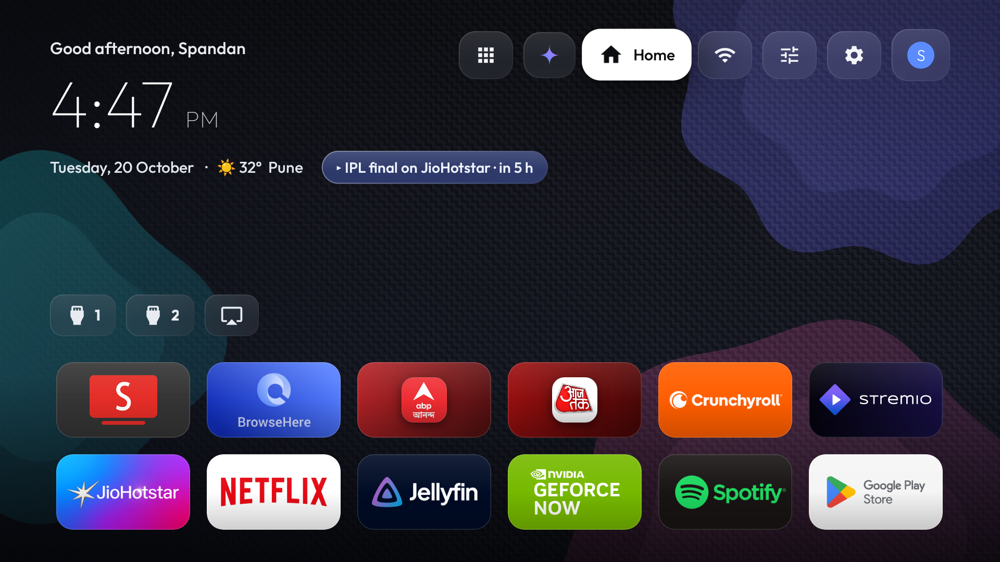
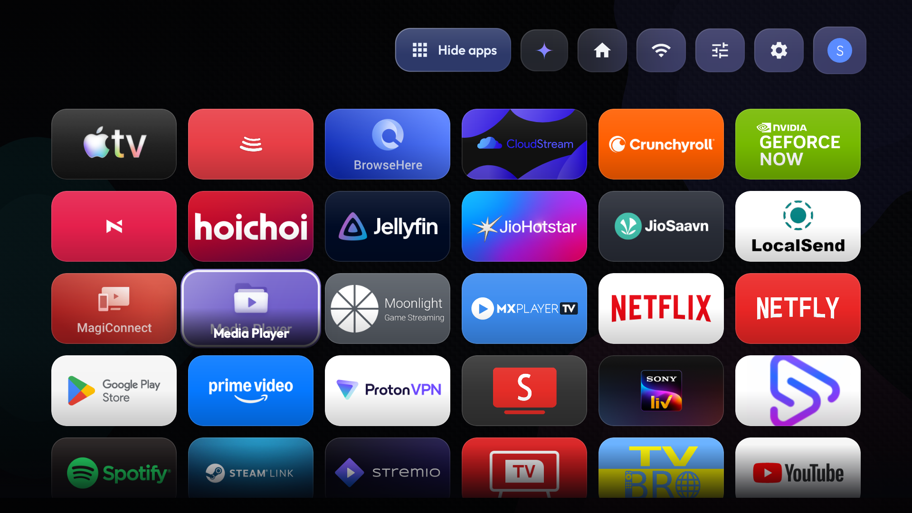

# tvHome: an Android TV launcher and debloat kit

A single-activity Android TV launcher (`com.spandan.tvhome`) with wide Apple-TV-style cards,
frosted "liquid glass" chrome, profiles, a generated Material-You-Expressive wallpaper, an
icon-only top bar, a customizable input strip, weather and a 12-hour clock. It ships with a
screenshot-verified, fully reversible debloat for the TCL 55" T89C (G08, Android 14), but the
launcher works on any Android TV / Google TV that allows sideloading.

<p>
  
  
</p>

**Highlights**
- Wide 16:9 cards (uses each app's TV banner, otherwise a card tinted from its icon), lift + gloss focus, names optional
- Profiles ("Who's watching"): own pins, inputs, clock/weather prefs and name per profile
- Customize pill: pick home apps, show/hide inputs, 12/24h clock, weather, °C/°F, app names, wallpaper
- Liquid-glass pills and panels over a pre-blurred wallpaper (no live blur, cheap on 2 GB devices)
- Add your own shortcuts per profile: websites/web apps, YouTube live/search via SmartTube (e.g. a news channel), or any app deep link (favicons fetched automatically)
- Recent apps appear after the inputs; wallpapers: generated, plain, or your own photo (copy to the app's `wallpapers/` folder or paste an image link in the TV)
- First run asks your name; with 2+ profiles a "Who's watching?" screen appears on startup (toggle in the profile menu)
- No root, no Play Store: debloat is `pm disable-user` only and `tools/restore.sh` reverses it

## Quick start

```
git clone <this repo> && cd tvhome
cp tools/local.env.example tools/local.env   # set TV_SERIAL (adb ip:port) and your name
tools/build-install.sh                        # builds with the Android SDK + JDK 17 and installs
```
Requirements: Android SDK platform 34 + build-tools 34.0.0 (`~/Library/Android/sdk` by default),
JDK 17, `adb`, and Wireless debugging enabled on the TV. Everything private (TV address, your name,
Wi-Fi/hotspot strings) lives in the git-ignored `tools/local.env`.

> The notes below are the author's own TCL TV log: serial/IP placeholders are shown as `<...>`.

---

# TCL TV Debloat + tvHome Launcher

Setup for the TCL "Smart TV Pro" (G08, 55", Android 14) in the living room:
a screenshot-verified system-app debloat, plus **tvHome**, a custom Apple-TV-style
launcher (`com.spandan.tvhome`) that replaces the ad-supported stock Google TV launcher.

> Golden rule: **never uninstall** a system package. Everything is
> `pm disable-user --user 0`, and `tools/restore.sh` brings it all back.

---

## Serial / connection

The TV is on Wi-Fi at `<tv-ip>`. It is paired for ADB over TLS via
wireless debugging (paired once; the pairing persists).

- Current serial: `<tv-ip>:<port>`
- **The port rotates whenever the TV's adbd restarts** (TV reboot, or the
  "Wireless debugging" toggle being cycled). Older was `<old-port>`. If `adb connect`
  is refused:
  - Toggle *Settings → Device Preferences → Developer options → Wireless debugging*
    off then on, then check `adb devices`; recent adb auto-discovers the TV
    over `mDNS` and it will show up as
    `adb-<device-id>-….…._adb-tls-connect._tcp` (that serial also works
    directly with `adb -s`).
  - Or rediscover the port: `dns-sd -L "adb-<device-id>" _adb-tls-connect._tcp local.`
  - If the TV was asleep, wake it with the remote first (adb TLS stops while the
    panel is asleep; Wi-Fi/LAN and Chromecast stay up).

All scripts below accept the serial as an argument and default to
`<tv-ip>:<port>`.

## Debloat

- Manifest: `tools/disable-list.txt` (5 batches, each verified by screenshot
  before being applied). Covers TCL cleaner/telemetry/retail-demo junk,
  content & partner rows, setup remnants, and the heavyweights.
- Kept (disabled at some point but re-enabled): `com.tcl.gamebar` (PC on HDMI,
  VRR toggles), casting, OTA, TCL account/USB media, MagicConnect, voice
  (Gemini/katniss + TCL eva).
- `com.tvos` is NOT an app: it is the tvos framework resource overlay; excluded.
- Reverse it: `tools/restore.sh [serial]` (re-enables everything in the list and
  prints how to switch the default home back to the stock launcher).

## tvHome launcher

Single-file app: `launcher/app/src/main/java/com/spandan/tvhome/MainActivity.java`.
Two modes:

- **Home (default)**: a clean "ambient" screen: greeting, clock, date and the
  "up next" reminder held in the free space above the shelf, the pill bar in the
  top-right corner, and the dock at the bottom. No app grid; home focus starts on
  the dock so DOWN/OK is an app launch.
- **All apps**: the pill with the 2×2 glyph (`All apps` / `Hide apps`) slides the
  alphabetical grid over the hero and moves focus into it. BACK closes the drawer
  and returns focus to the dock, and leaving the launcher (launching an app, the
  assistant, another input) always collapses back to the clean home.

Zones: top pill bar (All apps / Inputs / Home / Wi-Fi / Settings) → app grid
(6 columns, only while the drawer is open) → dock band. Glass focus highlight,
dim scrim over the drawer while the dock is focused, scroll-aware top/bottom
fades, Outfit font, average-icon-color title glow.

Navigation when the drawer is closed: UP from the dock reaches the pills, DOWN
from the pills goes straight to the dock. When the drawer is open, DOWN past the
last row (and UP from the dock) crosses between the grid and the shelf.


### Inputs panel

The Inputs pill lists Live TV plus every TV input (HDMI 1–4, AirPlay, TV…) and
tunes to it in-place with a `TvView`; BACK returns to the launcher. A card in the
bottom-left names the input, then:

- `BACK to return`: the input has a picture (HDMI content is a protected layer,
  so `screencap` returns a 0-byte PNG while it is on screen, which is normal);
- `No signal · check the source · BACK to return`: the port is live but nothing
  is plugged in / the source is asleep. Empty HDMI ports look like a plain black
  screen otherwise, which is why the card exists.

### Build & install

```
tools/build-install.sh [serial]
```
(aapt2 → javac → d8 → zipalign → apksigner → `adb install -r`. After every
reinstall it also re-grants BLUETOOTH_CONNECT/SCAN and re-asserts the
default-home preference: reinstall clears runtime grants.)

### Default home

```
cmd package set-home-activity com.spandan.tvhome/.MainActivity
pm disable-user --user 0 com.google.android.apps.tv.launcherx
pm disable-user --user 0 com.google.android.tungsten.setupwraith
```
`launcherx` is the stock Google TV launcher (the one with the ad banner);
`setupwraith` is Google's setup/splash HOME fallback that otherwise steals the
HOME key once `launcherx` is off. Both are in `tools/disable-list.txt` (batch 5).
The input adapters/grid etc. are untouched by this.

To go back to stock (after `restore.sh`):
```
cmd package set-home-activity com.google.android.apps.tv.launcherx/.home.HomeActivity
```

### A third-party launcher stealing HOME

Projectivy Launcher (`com.spocky.projengmenu`) ships an accessibility service that
re-launches itself right after HOME starts, so the TV bounces to Projectivy even
though `dumpsys package preferred-activities` says tvHome is the always-HOME app.
Evidence in logcat: `START … cmp=com.spandan.tvhome/.MainActivity` followed a
second later by `START … cat=[android.intent.category.LEANBACK_LAUNCHER]
pkg=com.spocky.projengmenu … from uid 10000` (uid 10000 = Projectivy itself).

Fix (keeps the app installed and launchable from the grid):
```
adb -s <serial> shell settings put secure enabled_accessibility_services ""
```
Re-enable it inside Projectivy only if you actually want that launcher to win.

### Customizing

All in `launcher/app/src/main/res/values/config.xml`, then re-run
`tools/build-install.sh`:

- **Dock order / entries**: `dock_pkg` / `dock_label` / `dock_data` /
  `dock_icon` (all index-aligned). Plain item = launch the app;
  `package|https://…` = deep link inside that package (used for the SmartTube
  channel shortcuts ABP Ananda / Aaj Tak). Labels can be empty = use the app's
  own label. Dock entries are automatically hidden from the grid.
  `dock_icon` is a drawable name from `res/drawable-nodpi` (e.g. `ic_ch_abp`,
  `ic_ch_aajtak`), used for URL shortcut tiles so they don't all show the
  SmartTube logo.
  SmartTube deep links: `https://www.youtube.com/@handle` and
  `/channel/UC...` open SmartTube's channel view but hang on a spinner, while
  `https://www.youtube.com/results?search_query=...` works, so the ABP Ananda /
  Aaj Tak tiles use live search URLs.
  The dock shelf auto-fits up to 9 tiles by shrinking slots and only scrolls
  beyond that.
  Current dock: SmartTube · BitChord TV · Browser · ABP Ananda · Aaj Tak ·
  Crunchyroll · Stremio · CloudStream · MiXplorer (MiXplorer slot auto-skips
  while the app is not installed; sideload it to activate).
- **Grid exclusions**: `grid_exclude` (also covers leftover TCL stubs).
- **Greeting name / Wi-Fi SSID label**: `greeting_name`, `wifi_name`.
- **Google Home light shortcuts**: `home_cmd_label` / `home_cmd_query` pairs,
  surfacing in the *Home* pill's dropdown (Wi-Fi panel). Currently: movie mode,
  master-bedroom on/off/dim/amber, all lights off. Edit both arrays in the same
  order.

### Reminders / schedule file

Plain text file, no calendar provider needed:
```
adb push my-schedule.txt /sdcard/Android/data/com.spandan.tvhome/files/schedule.txt
```
(safer alternative: send it with LocalSend to the TV and move it there with
MiXplorer once sideloaded). Format: one entry per line, `#` comments:

```
2026-11-02 19:30 IPL watch party
21:30 Evening lights        # HH:mm = repeats daily
```
Entries show in the top-left "up next" pill with a countdown.

### Wi-Fi hotspot (optional)

Android TV has no in-app hotspot toggle, so start/stop it from a computer:

```
tools/hotspot.sh start          # SSID/passphrase from tools/local.env (wpa2)
tools/hotspot.sh stop
tools/hotspot.sh status
```
Set `TVHOME_HOTSPOT_SSID` / `TVHOME_HOTSPOT_PASS` in `tools/local.env`, or edit
`hotspot_ssid` / `hotspot_pass` in config.xml. The TV keeps its own Wi-Fi
connection while the hotspot is on, so it stays usable as a client too.
The Settings-Wi-Fi pill also shows the SSID/pass as a reminder.

### Permissions

`BLUETOOTH_CONNECT` / `BLUETOOTH_SCAN` (for the "connected Bluetooth devices"
list on the Wi-Fi panel) are runtime-granted with `pm grant`: build-install.sh
re-applies them after every reinstall:
```
adb -s <serial> shell pm grant com.spandan.tvhome android.permission.BLUETOOTH_CONNECT
adb -s <serial> shell pm grant com.spandan.tvhome android.permission.BLUETOOTH_SCAN
```

## Assistant / Gemini commands

Asking the TV anything by voice, or from the Home pill, got stuck on the
"Verify network change: we need to verify your identity to resume using home
controls" screen, and katniss crashed in the background with
`ActivityNotFoundException ... com.google.android.apps.tv.launcherx/.networkreauth.NetworkReauthActivity`.

Cause: that re-verification screen belongs to the stock Google TV launcher, and
`launcherx` is disabled for the debloat (see *Default home*), so the activity is
missing and katniss cannot show it.

Fix:
```
tools/fix-assistant.sh [serial]
```
It clears `com.google.android.katniss`, then the one-time setup is finished on
the TV with the remote: **Allow** on "Search across all your TV apps",
**No, thanks** on "Activate Voice Match" (or Agree if you want voice match), let
the HomeGraph step finish and go back to the home screen. Without that, every
assistant command re-opens the verify dialog. Voice Match can be enabled later
from Google Home settings.

Verify by pressing the Google Assistant / Gemini command from the Home pill: the
answer should appear instead of the dialog.

### Gemini vs Google Assistant

Gemini for TV has **no on/off switch**: Google turns it on when the TV sits in a
Google Home that has acknowledged Gemini for TV, and removing the TV from that
Home silently gives you Google Assistant again. Requirements are Android 14+
(this TV: Android 14, India, en-IN), so the switch is entirely account/Home side.

`pm clear com.google.android.katniss` (step above) resets that link, which is why
the TV can come back as plain Google Assistant. The TV reports the state on every
assistant launch:

```
tools/check-gemini.sh [serial]
```

`Gemini enabled : false, geminiChatDeviceEligible: false` means the TV is no
longer recognised as Gemini-eligible. To get it back, on the phone: Google Home
app → make sure the TV is in the Home where Gemini was acknowledged (add/move it
if the `pm clear` dropped it), then relaunch the assistant and re-check. The
setting itself lives in Settings → Accounts & Profiles → <account> → Voice
assistant, but that row only appears once the device is eligible again.

## Private DNS (ad blocking)

Optional: the author uses AdGuard (`dns.adguard-dns.com`) as Private DNS.

Caveats, on record:
- It blocks the vast majority of tracking/ads across apps and the web view, but
  **not** YouTube in-app ads: YouTube uses the app's own server-side mechanism.
- To undo:
```
adb -s <serial> shell settings put global private_dns_mode opportunistic
```
  (or Settings → Network & Internet → Private DNS → Automatic)

## Other scripts

- `tools/actions.py <pkg>…`: dumpsys resolver-table parser, handy to find which
  activities handle an intent when wiring new deep links.
- `backup/`: full `dumpsys package` etc. taken before any change.

## When you're done tinkering

Turn both debug toggles off in
*Settings → Device Preferences → Developer options*:
- **USB debugging: OFF**
- **Network debugging / Wireless debugging: OFF**
(an open ADB listener is still an
unnecessary hole; nothing in tvHome needs it at runtime).

## Shots

Verification screenshots for every change live in `shots/` (shot1–shot147,
ordered). Latest layout state: shot144 (clean home after launching from the
drawer), shot146 (pill focus), shot136 (app drawer with scroll fade), shot147
(Inputs panel with the shifted pill order).

### Home customization (in-app, no rebuild)

Everything below lives behind the **Customize** pill (sliders icon) in the top row.
Pills are icon-only; the focused pill expands to show its name.

- **Edit home apps**: opens All apps with a ✓ / + badge on every card. OK pins or
  unpins, BACK saves. Up to 18 pins; the shelf grows to fit. Stored in prefs (`pins`),
  defaults come from `pin_default` in `config.xml`.
- **Show on home …**: choose which inputs appear in the strip (default: HDMI 1,
  HDMI 2, AirPlay; Live TV is hidden because the TCL tuner app already switches to
  HDMI 1) and toggle the ABP Ananda / Aaj Tak shortcuts.
- **Clock** 12-hour with AM/PM (default) or 24-hour; **Weather** on/off; **°C/°F**.
  Weather is Open-Meteo, located once from your IP (`ipwho.is`). Pin a place with
  `weather_lat` / `weather_lon` / `weather_city` in `config.xml`.
- **Reset home apps** restores the default pins.
- The **Gemini** pill opens the TV assistant overlay (same as the Assistant button;
  on this TCL build that is still the classic Google Assistant UI).

Cards: apps that ship a TV banner show it full-bleed; others get a card tinted from
their icon colour. Names appear inside the card on focus (home and All apps).

### Google Home commands

The Home pill runs spoken-style phrases through the TV assistant. Add your own under
Home > Add command. The assistant handles one request per phrase and answers "Sorry, I
didn't understand" to combined ones such as colour plus brightness, so chain steps with
`;` and tvHome sends them one after another, 7 seconds apart:

```
set master bedroom to cool white ; set master bedroom brightness to 100 percent
```

Use the device name exactly as Google Home shows it (here the bulb is called "Master").
If a phrase falls through to a web search, the assistant did not match a device or action.
